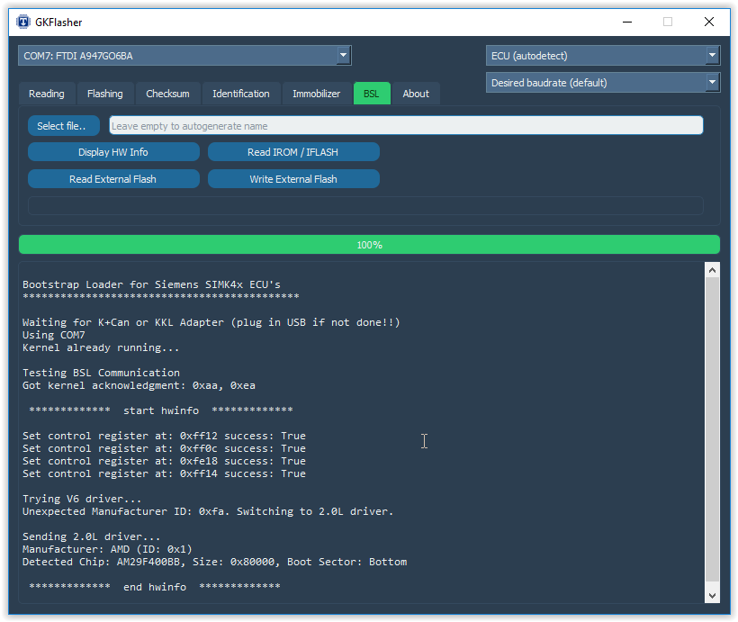
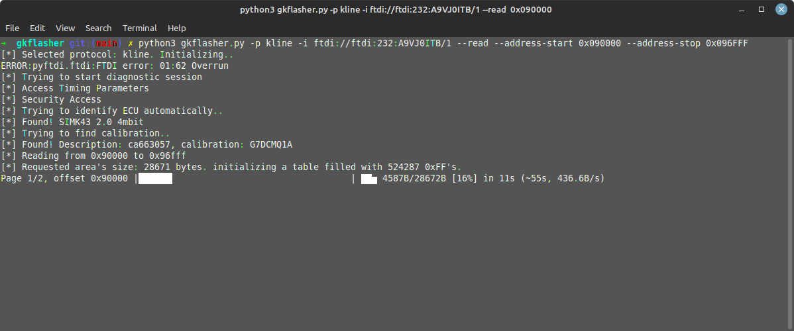

# GKFlasher

CLI flashing tool for SIMK41/SIMK43/SIM2K based vehicles. This project is a result of research gathered by black-box reverse engineering.

It can read & write ecu calibration data / program code, correct EEPROM checksums, clear adaptive values and program the immobilizer. It also provides BSL support for your ECU ([docs/bsl.md](docs/bsl.md)).

This project is supported by [OpenGK.org](https://opengk.org/)




## Installation 

We have precompiled MSI install packages available from the GitHub releases page.

Alternatively:

Clone the repository

`git clone https://github.com/Dante383/GKFlasher`

Install Python 3.12 for your specific operating system
https://www.python.org/downloads/

Install required packages

`python3 -m pip install -r requirements.txt`

Assemble the loader binaries from source (required when running from a checkout):

`python3 tools/build.py`

Alternatively, `make build` runs the same build process. Release packages already
include the generated assets.

Confirm that no errors ocurred

Running the command `pip list` should show the following packages
-about-time
-alive-progress
-crcmod
-gkbus
-grapheme
-pyftdi
-PyQt5
-PyQt5-Qt5
-PyQt5-sip
-pyserial
-pyusb
-PyYAML
-setuptools
-python-can

## Usage 

Connect your K-line or CANbus adapter to your computer and the vehicle (or ECU for bench setup).
Pinouts for the Tiburon can be found on https://opengk.org. 

### GUI

Launch `python3 gui.py` 

The GUI uses Qt's Fusion style. Linux uses bundled DejaVu Sans fonts; Windows
uses its native UI font and installed Consolas font. Keep `assets/fonts/` with the
application; no font installation is needed. The packaged GUI includes these
assets and their licence.


### CLI

Launch `python3 gkflasher.py --protocol {canbus/kline} --interface {can0//dev/ttyUSB0}`. If it detects EEPROM size and calibration - all is good, you can proceed! 

### Reading 

Add `--read` to the parameters. By default the output
will be saved to `output_{address start}_to_{address stop}.bin`. You can use `--output {filename}` to override that

You can use `--address_start` and `--address_stop` to only read a certain portion.

Be aware that GKFlasher will always pad the output with 0xFF's to match the EEPROM size. For example, reading 16384 bytes from 0x090000 to 0x094000 (calibration zone) on 
an 8mbit EEPROM will still result in a 1mb output file. 

### Flashing 

Add `--flash {filename}` to the parameters. GKFlasher will attempt to detect current ECU calibration version 
and the calibration version of the file you're trying to flash before asking you for confirmation.

You don't need to flash the whole bin at once. You can also use `--flash-calibration {filename}` and `--flash-program {filename}`

You can use `--address_start` and `--address_stop` to only overwrite a certain portion. Be aware that input file offsets must match with intended EEPROM offset. 
For example, if you want to flash only the calibration zone (0x090000 - 0x094000 on 8mbit eeprom) the calibration zone must be located at 0x090000 - 0x094000 in the input file.
This behaviour is followed by default by GKFlasher's --read command.

### Parameters 

`-c --config {filename}` - Load the config file (default: gkflasher.yml). You could use this for example to prepare different configurations for different vehicles you're working on.

`-p --protocol {protocol}` - Currently supported: `canbus` and `kline`

`-b --baudrate {baudrate}`

`--desired-baudrate {baudrate identifier}` - See ecu_definitions.py for presets.
When omitted, normal K-Line diagnostics identify the ECU at 10400 baud and
automatically discover the fastest validated candidate (up to 750000 baud).
Discovery compares repeated calibration reads; it uses no firmware-version lookup
or firmware patches. Explicit selectors bypass discovery; use `0x01` to stay at
10400 baud. The GUI's default `Desired Baudrate (automatic)` uses the same path
and displays the selected rate. CAN remains fixed at its configured bitrate;
MTOS/RSW automatically qualify their RAM-loader link independently of KWP.
BSL has its own Automatic selection. Explicit numeric selections bypass discovery.

Discovery keeps default diagnostic timing during probes, restores 10400 baud
after a failed handoff, and stops if recovery fails. An unresponsive handoff can
require six seconds of silence. If calibration reads are denied, discovery keeps
10400 baud. A short read qualification cannot guarantee every firmware's write
reliability; an explicit lower selector remains available for such firmware.

Selector `0x06` sends a custom baudrate supplied by `--session-baudrate`.

`--session-baudrate {baudrate}` - Override the physical K-Line speed after selecting a
session with `--desired-baudrate`. The selector sent to the ECU is unchanged.
With selector `0x06`, this value is also sent to the ECU as three big-endian bytes.

`--kline-p4-min {milliseconds}` - Set the gap between request bytes (0 inclusive to 18 ms exclusive).
Positive values enable echo-paced serial transmission with an 18 ms byte-gap guard,
leaving margin below the tested ECU's 22 ms receive deadline. Startup uses contiguous
frames before enabling pacing at the selected session speed. In this mode, lost KWP
memory-read responses get up to three attempts with a bounded response wait
that includes the reply wire time at the selected baudrate, instead of the
normal long timeout. Writes and programming commands are never
automatically replayed after a response timeout. These are per-connection I/O settings;
the installed FTDI driver and its persistent settings are not changed.
On serial adapters, a nonzero value waits for each byte's echo before the next gap
and byte. This requires the companion gkbus serial echo-pacing change. Omit the option
to keep the existing timing. These options apply to normal K-Line diagnostics, not BSL or MTOS.

For an experimental calibration read with selector `0x05`, a 107143-baud interface,
and echo pacing:

```powershell
python gkflasher.py --protocol kline --interface COM69 --desired-baudrate 0x05 --session-baudrate 107143 --kline-p4-min 0.2 --read-calibration
```

```powershell
python gkflasher.py --protocol kline --interface COM69 --desired-baudrate 0x06 --session-baudrate 32609 --read-calibration
```

 Note: `0x06` is currently a CLI option; it is not a fixed-rate entry in the GUI dropdown.

`-i --interface {interface}` - for example `/dev/ttyUSB0` or `COM3` (K-Line), `can0` (SocketCAN), `pcan:PCAN_USBBUS1` (python-can interface:channel) or `j2534:openport` (J2534 adapter, K-Line and CAN; `j2534` for the first installed one). If the interface isn't found, GKFlasher lists the available ones to choose from

`-r --read`

`--read-calibration` - Read just the calibration zone. You can always use `--address-start` and `--address-stop` manually - this just adjusts the offset based on the ECU for you

`--read-program` - Read just the program zone.

`--id` - display ECU identification parameters (KWP service 0x1A)

`--correct-checksum {filename}`

`--clear-adaptive-values`

`-o --output {filename}` - Filename to save the EEPROM dump

`-f --flash {input filename}`

`--flash-calibration {input filename}`

`--flash-program {input filename}`

`-s --address_start {offset}` - Offset to start reading/flashing from 

`-e --address_stop {offset}` - Offset to stop reading/flashing at

`--bin-to-sie {input filename}` - Convert BIN to SIE for (Chip-off) Flashing

`--sie-to-bin {input filename}` - Convert SIE to BIN after (Chip-off) Flashing

`--bsl` - Bootstrap loader, with the ECU in boot mode: read/write the whole external flash (boot sectors included) or read the internal ROM, on the K-line interface. See [docs/bsl.md](docs/bsl.md). Use with `--bsl-mode {hwinfo,read,readint,write}`, `--bsl-image {file}`, `--bsl-baudrate`, `--bsl-driver {auto,i4,v6}`.

BSL defaults to automatic discovery: it connects at the 57600-baud entry rate,
then qualifies the fastest supported candidate up to 750k baud.

See the BSL wiring instructions before connecting an adapter to the board.

`--mtos` - Mini Test Operating System - upload and execute a small routine in ECU RAM. See [docs/mtos.md](docs/mtos.md). Use with `--mtos-key`, `--mtos-mode {hello,dump,payload,loader,probe,read,read-calibration,flash-calibration,fullflash}`, and `--mtos-payload {file}` for write/payload modes.

K-Line MTOS starts at 10400 baud, then uses Desired Baudrate for RAM transfers
(automatic discovery by default). Select 750000 in the GUI, or pass `--desired-baudrate 0x06`
in the CLI. `0x05` selects 125000; `--session-baudrate` can override the MTOS
transfer rate. These MTOS settings do not change the initial KWP baudrate.
CAN MTOS uses the RSW CAN message objects at the selected CAN bitrate, with the
same flash driver and verification as the K-Line kernel. Custom `payload` and
`loader` files currently require K-Line.

Optional MTOS write arguments:
`[--no-verify] [--skip-backup] [--force-write] [--override-safety-checks]`.

- `--no-verify` (alias `--skip-verify`): skip read-back verification.
- `--skip-backup`: do not save a backup; preservation/comparison may still require a read.
- `--force-write`: rewrite all selected sectors, even when they already match.
- `--override-safety-checks`: allow unrecognized BIN identifiers; size, reset-vector and hardware checks remain.

These options apply to `flash-calibration` and `fullflash`. MTOS uses qualified
2 KiB XRAM staging and LZSS compression when it saves enough data, otherwise raw
blocks. The decoder validates each compressed block before calling the existing
flash driver. Normal sector and final verification remain enabled by default.

`--mtos-attach` is the recovery path for a kernel left running after a failed
write. Keep ECU power on and reuse the same interface and write mode; do not
start a normal KWP session against the running kernel.
Use the explicit baudrate in the previous job's recovery command. Without one,
attach checks the 57600 entry rate retained by successful automatic BSL sessions.

The GUI also offers **750000 baud** for normal K-Line diagnostics on compatible
OpenGK firmware. It sends custom selector `0x06` with the requested rate. The
default is automatic discovery; this option does not change the CAN bitrate.

RSW flashing is available over CAN and K-Line on supported SIMK43 I4 layouts.
For K-Line, supply the ECU's Siemens key with `--rsw-key`. The desired baudrate
selects the RAM transport speed (automatic by default; `0x06` explicitly selects 750000).
The RSW tab provides the same key field and uses the Desired Baudrate dropdown.

```bash
python gkflasher.py --protocol kline --interface COM69 --rsw-cal firmware.bin --rsw-key 0x2d381c78 --desired-baudrate 0x06
```

K-Line runs the actual native RSW command/erase/program/checksum routines from
RAM. MTOS supplies only the RAM bootstrap and the existing kernel UART RPC;
it does not use the MTOS flash programming backend. No persistent firmware
patch or RSW flash installation is needed. See [RSW details](docs/rsw.md).
K-Line virginization is unavailable: the bundled native RSW sector table does
not define that erase region.

`--rsw-boot1 {input filename}` - Flash Boot1 using RSW bootstrap

`--rsw-boot2 {input filename}` - Flash Boot2 using RSW bootstrap

`--rsw-asw {input filename}` - Flash ASW using RSW bootstrap

`--rsw-cal {input filename}` - Flash CAL using RSW bootstrap

`--rsw-full {input filename}` - Flash full image set using RSW bootstrap

`--rsw-virginize` - Virginize ECU using RSW bootstrap

`--immo` - Immobilizer functions

`-v --verbose` - Enable debug logging

`-l --logger` - Start KWP2000 Datalogger 


### OpenGK high-speed K-Line

See [OpenGK high-speed K-Line](docs/high-speed-kline.md) for firmware requirements,
transfer timing and MTOS options.

### Optional KWP compression

Compatible OpenGK firmware advertises `OGKLZS01` and enables CRC16-checked LZSS
for ordinary calibration/program reads and writes, in both CLI and GUI. No new
option is needed. Other firmware retains standard KWP transfers. Compressed
blocks fit the existing KWP frame size; write acknowledgements are never blindly
replayed. The matching custom firmware extension is required for KWP, whereas
BSL uploads its shared codec to RAM without changing ECU firmware.

### Kernel sources

The OpenGK bootstrap, command kernel, flash drivers and SIMK43 RSW are maintained
as assembly source. The build generates their binaries and the MTOS CAN stage
under `build/out`; GitHub builds them before packaging.
See the [kernel and build instructions](docs/kernel.md) and [flash-driver documentation](docs/driver.md).
